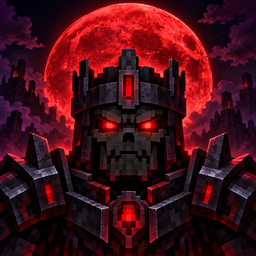

# Bloodmoon & Bosses

<p align="center"></p>

Mod de Fabric para **Minecraft Java 26.3** en el que los mobs hostiles aparecen con **niveles**. Cuanto más lejos del spawn del mundo y cuanto más viejo es el mundo, más nivel tienen: más vida, más daño, más armadura y más velocidad, y aparecen con mejor equipo encantado. El nivel y la vida se ven en el nombre del mob: **"Zombi [Nv 7] ❤ 34/40"**. Los mobs de más nivel también sueltan más loot, ítems raros y más experiencia.

Cerca de la base el juego se siente casi como vanilla; a varios miles de bloques, salir a explorar es otra cosa.

## Cómo funciona

| Nivel (dónde) | Vida de un zombi (base 20) | Daño sin arma (base 3) | Armadura extra | Loot | Experiencia |
|---|---|---|---|---|---|
| 1 (en el spawn) | 21,6 | 3,1 | +0,1 | normal | ×1,05 |
| 20 (~1900 bloques) | 52 | 5,4 | +2,4 | ×2 | ×2 |
| 50 (~4900 bloques) | 100 | 9 | +6 | ×4 | ×3,5 |
| 80 (~7900 bloques) | 148 | 12,6 | +9,6 | ×6 | ×5 |
| 100 (máximo, ~9900 bloques) | 180 | 15 | +12 | ×7 | ×6 |

- **El nivel sube 1 cada 100 bloques** desde el spawn del mundo, con una variación de ±1 para que no sean todos iguales.
- **Con el tiempo:** cada 5 días del mundo, los mobs que aparecen suman 1 nivel, hasta +20 a los 100 días, en cualquier zona. Cuentan los días del reloj del mundo (los que muestra F3): dormir los adelanta, y `/time set` los puede atrasar. Los mobs que ya estaban no cambian.
- **Campeones:** uno de cada 20 mobs (5 %) aparece con 10 niveles más que su zona y con un **afijo** que se ve en el nombre: **"Zombi [Nv 27] [Vampiro]"**. Ver [Eventos y afijos](#eventos-y-afijos).
- La distancia, el tiempo y los campeones se suman, y todo se corta en el nivel 100. La tabla de arriba es sin el tiempo ni los campeones.
- **Todo sigue subiendo hasta el nivel 100:** ninguna estadística llega a su tope antes, así que alejarse siempre se nota.
- **Pensado para jugarse con Hero's Forge:** con el equipo y los puntos que se esperan en cada zona, un zombi se mata en 5 o 6 golpes en todo el mundo, y lo que aguantás va bajando hacia el nivel 100. Sin ese mod, la zona de nivel 100 es para pocos: un zombi aguanta 19 golpes de una espada de netherita con Filo V.
- **Nether:** cada bloque cuenta como 8 (como los portales) y suma 20 niveles. **End:** se mide desde el centro de la isla principal y suma 40.
- **El color del nombre** indica el rango, por quintos del nivel máximo: gris (1–19), verde (20–39), azul (40–59), violeta (60–79), dorado (80+).
- **El nombre se ve al mirar al mob**, no a través de las paredes.
- **La vida del nombre se actualiza sola** cuando el mob recibe daño, se cura o le cambia la vida máxima (`vidaEnElNombre` la apaga).
- **Creepers de nivel 60 o más** explotan con un radio más grande.
- **Equipo:** zombis, esqueletos, piglins y sus variantes pueden aparecer con armadura extra. La probabilidad de cada pieza es 0,75 % por nivel (hasta 50 %, desde el nivel 67) y el material depende del nivel:

  | Nivel | Material |
  |---|---|
  | 1–19 | cuero |
  | 20–39 | cadena u oro |
  | 40–59 | hierro |
  | 60–79 | diamante |
  | 80+ | netherita |

  - **Los que se queman al sol no reciben casco** (zombis, esqueletos): si no, sobrevivirían de día. El casco que les pone vanilla no se toca.
  - **Las armas y la armadura salen encantadas** según el nivel (en nivel 67, como una mesa de encantamiento de nivel 20). Con un arco, eso le da Poder: así escala el daño de los esqueletos.
  - **Es más fácil que suelten su equipo:** +0,2 % por nivel sobre la chance de vanilla, hasta 25 %. El equipo de diamante o netherita y los tridentes siguen con la chance de vanilla (8,5 %), y lo que vanilla no suelta nunca (la espada de los vex) sigue sin soltarse. Como en vanilla, sólo sueltan el equipo si los mataste vos.
- **Loot:** cada 16 niveles el mob tira su loot de vanilla una vez más (hasta 6 veces extra, desde el nivel 96). **Sólo si lo matás vos**: a un mob que muere en una granja automática, por lava o por caída sin que lo hayas golpeado, le toca el loot normal. El equipo que lleva puesto no se multiplica.
- **Evocadores:** también tienen tiradas extra, pero cada una sale **por probabilidad**: 0,5 % por nivel, hasta 50 %. Un evocador de nivel 60 tiene 3 tiradas extra al 30 % cada una (en promedio, casi un tótem extra); uno de nivel 100 tiene 6 al 50 % (3 tótems extra en promedio). Está en el tag `bloodmoonandbosses:tiradas_extra_por_chance`.
- **Sin loot extra:** esqueletos del Wither (las calaveras serían triviales) y shulkers. Están en el tag `bloodmoonandbosses:sin_tiradas_extra`.
- Los dos tags se pueden cambiar con un datapack.
- **Ítems raros:** además de su loot, un mob con nivel que matás vos puede soltar un ítem de una de estas tablas. Cada una se sortea por separado:

  | Tabla | Desde el nivel | Probabilidad | Qué puede dar |
  |---|---|---|---|
  | Rara | 20 | 15 % | manzana dorada, diamantes, esmeraldas, hierro, libro encantado, botellas de experiencia, perlas de ender, etiqueta |
  | Épica | 50 | 10 % | diamantes, manzanas doradas, libro encantado de nivel 30, espada o pico de diamante encantados, chatarra de netherita, plantilla de mejora de netherita |
  | Legendaria | 80 | 5 % | manzana dorada encantada, lingote de netherita, plantilla de mejora de netherita, armadura de diamante con encantamientos altos, diamantes |

  Las tablas son `bloodmoonandbosses:botin_por_nivel/raro`, `epico` y `legendario`: se pueden cambiar con un datapack. También aplican a los esqueletos del Wither y los shulkers.
- **Experiencia:** +5 % por nivel. Como en vanilla, sólo se da si lo mató un jugador.
- Con `/gamerule mobDrops false` no hay loot extra, igual que no hay loot normal.
- **Qué mobs tienen nivel:** los hostiles que aparecen solos en el mundo, en estructuras (mansiones, fortalezas, ciudades del End…), en patrullas y en raids. **No tienen nivel** los de spawners (para que las granjas no cambien), los de huevos o comandos, ni los jefes (dragón, wither, guardián anciano, warden).
- **Conversiones:** un zombi que se ahoga sigue con su nivel ("Ahogado [Nv 7]"), los slimes chicos heredan el nivel del grande, y un aldeano zombi curado vuelve a ser un aldeano normal.
- **Name tags:** si le ponés un name tag a un mob con nivel, el nombre pasa a ser el tuyo (se pierde el "[Nv N]"), pero sigue igual de fuerte.
- Los mobs con nivel desaparecen igual que en vanilla: el nombre no los vuelve permanentes.

### Eventos y afijos

Ninguno necesita el mod en el cliente: usan la barra de jefe, los títulos y los sonidos de vanilla.

- **Afijos de campeón:** cada campeón tiene uno al azar, y lo conserva si se convierte (un zombi que se ahoga sigue siendo veloz). **Cada afijo suelta sus partículas** cada medio segundo, así se reconoce de lejos o en una cueva antes de leer el nombre.

  | Afijo | Partículas | Qué hace |
  |---|---|---|
  | **Veloz** | polvo en los pies | Corre un 30 % más rápido |
  | **Vampiro** | esporas rojas | Se cura la mitad del daño que hace (también con flechas). Los creepers no pueden serlo |
  | **Explosivo** | humo y chispas arriba de la cabeza, como una mecha | Al morir suena la mecha de un creeper y, un segundo y medio después, explota como uno. No rompe bloques |
  | **Invocador** | violetas, de bruja | Cuando lo lastimás llama dos refuerzos de su especie, con el nivel de la zona. Hasta 3 veces, cada 10 segundos. Los vex no pueden serlo (tag `bloodmoonandbosses:no_invocan`) |
  | **Blindado** | chispas blancas | +6 de armadura y la mitad de resistencia al empuje |
  | **Venenoso** | gotas verdes | Sus golpes (también las flechas y la explosión de un creeper) envenenan: veneno II por 5 segundos |
  | **Congelante** | copos de nieve | Sus golpes dan lentitud II por 3 segundos, con la escarcha de la nieve polvo en la pantalla (no lastima por frío) |
  | **Teletransportador** | de portal | Cuando le pegás, la mitad de las veces aparece al lado tuyo, como un enderman. Como mucho cada 3 segundos: alejarse o tirarle flechas no alcanza |

- **Estampida:** de noche, si estás al aire libre en el overworld, en una zona de nivel 10 o más, hay un 3 % por minuto de que suene un cuerno a lo lejos y entre 6 y 16 mobs de la zona (más cuanto más alto el nivel) carguen contra vos, todos desde el mismo lado, más rápido de lo normal. Uno es el líder: un campeón con afijo. Una barra roja muestra cuántos quedan. **Si los jugadores matan al menos la mitad, te llevás una tirada de botín raro** (la épica desde el nivel 50, la legendaria desde el 80) directo al inventario. Si te morís, se dispersan o pasan 3 minutos, termina sin premio; los que se queman al amanecer no cuentan. Después hay 3 días de juego de respiro. Los mobs salen del tag `bloodmoonandbosses:estampida` (zombi, esqueleto, araña).
- **Luna de sangre:** las noches de luna llena hay un 50 % de que la luna sea de sangre (en promedio una cada 16 días). Aparece un título rojo y una barra que se vacía hasta el amanecer. Esa noche los mobs que aparecen en el overworld tienen **+10 niveles** (y por eso más loot), y la mitad de los que aparecen solos vienen con un compañero igual. `/bloodmoon zona` lo avisa. Dormir la saltea, como cualquier noche.
- **Jefe de zona:** en cualquier dimensión, en zonas de nivel 15 o más, hay un 1 % por minuto (con 2 días de juego de espera) de que aparezca un jefe a 16–24 bloques, a tu altura: 20 niveles más que la zona, el triple de vida, un afijo y 3 escoltas. Tiene una barra violeta que ven los jugadores a menos de 48 bloques. **Muerto por un jugador suelta siempre una tirada de botín raro**, como mínimo la épica, además de su loot normal. Si nadie se le acerca durante un minuto, se va.
  - **Contorno:** brilla con un contorno violeta, como el de la flecha espectral, que se ve incluso a través de las paredes: no se confunde con sus escoltas ni con los mobs comunes. Se apaga con `contorno` en la config.
  - **Furia:** cuando le queda la mitad de la vida, ruge, corre un 25 % más, pega un 30 % más y llama 2 escoltas más. La barra y el contorno se ponen rojos.
  - **Habilidades:** cada 10 segundos usa una, y la avisa un segundo antes con un sonido y un mensaje: una **onda de choque** que lastima (como un golpe suyo) y empuja lejos a los que están a menos de 6 bloques, o un **tirón** que trae hacia él a los que pelean desde lejos (de 6 a 24 bloques) y los frena un momento. Pelear pegado o de lejos todo el tiempo no sirve. Los jefes salen de los tags `bloodmoonandbosses:jefe_de_zona/overworld` (zombi, esqueleto, vindicador, bruja), `…/nether` (esqueleto del Wither, piglin bruto, blaze) y `…/end` (enderman).
- Los eventos no les tocan a los jugadores en creativo o espectador, ni en dificultad pacífica.

### Comandos

| Comando | Qué hace |
|---|---|
| `/bloodmoon zona` | Muestra el nivel de los mobs en la zona donde estás: lo que pone la distancia, lo que suman los días del mundo y la chance de campeón |
| `/bloodmoon invocar <entidad> <nivel> [afijo]` | Aparece un mob con ese nivel (y su equipo) delante tuyo, opcionalmente con un afijo (`veloz`, `vampiro`, `explosivo`, `invocador`, `blindado`, `venenoso`, `congelante`, `teletransportador`). Requiere ser operador |
| `/bloodmoon evento estampida [jugador]` | Larga una estampida contra vos o contra el jugador, sin esperar el sorteo, a cualquier hora (requiere ser operador) |
| `/bloodmoon evento jefe [jugador]` | Hace aparecer un jefe de zona cerca (requiere ser operador) |
| `/bloodmoon evento luna_de_sangre` | Empieza la luna de sangre; sólo de noche (requiere ser operador) |
| `/bloodmoon recargar` | Vuelve a leer `config/bloodmoonandbosses.json` sin reiniciar el servidor (requiere ser operador) |

### Configuración

En el primer arranque se crea **`config/bloodmoonandbosses.json`** con todos los valores por defecto. Editalo y usá `/bloodmoon recargar`, o reiniciá el servidor.

- **Al recargar, los mobs que ya están no cambian:** la vida, el daño, la armadura, el nombre y el equipo se ponen cuando el mob aparece. El loot, los ítems raros y la experiencia se calculan al morir, así que esos cambios valen enseguida.
- **Los eventos y los afijos también toman los valores nuevos enseguida**, salvo `velocidadVeloz`, que se pone al aparecer.
- **Si el archivo tiene un error** (JSON mal escrito, o un valor imposible como `bloquesPorNivel: 0`), se queda la configuración que había, el archivo no se toca y el error aparece en el chat y en la consola.
- Si falta una clave se usa su valor por defecto, y al leer el archivo se reescribe completo. Una clave que no existe se ignora con un aviso en la consola.
- Las escalas tienen la forma `{"porNivel": 0.08, "tope": 8.0}`: lo que suma cada nivel y el máximo.

| Clave | Por defecto | Qué hace |
|---|---|---|
| `bloquesPorNivel` | 100 | Cada cuántos bloques del spawn sube un nivel |
| `nivelMaximo` | 100 | Nivel máximo |
| `extraNether` / `extraEnd` | 20 / 40 | Niveles que se suman en el Nether y el End |
| `variacion` | 1 | Variación al azar del nivel (±) |
| `diasPorNivelExtra` / `nivelesPorTiempoMaximos` | 5 / 20 | Cada cuántos días del mundo los mobs suman un nivel, y el máximo que suma el tiempo (`diasPorNivelExtra` en 0 lo apaga) |
| `chanceDeCampeon` / `nivelesDeCampeon` | 0.05 / 10 | Probabilidad de que un mob aparezca como campeón (de 0 a 1), y cuántos niveles extra tiene |
| `escalarSpawners` | `false` | Si los mobs de spawners también tienen nivel |
| `nombreSiempreVisible` | `false` | Si el nombre se ve a través de las paredes |
| `idioma` | `"en_us"` | `en_us` o `es_ar`: el de los nombres de los mobs y la barra de la luna de sangre para quien no tiene el mod en el cliente, y el de la consola. Los títulos y mensajes los ve cada jugador en el idioma de su juego |
| `vidaEnElNombre` | `true` | Si el nombre muestra la vida ("❤ 34/40"). Al recargar, los mobs que ya están cambian la próxima vez que reciban daño o se curen |
| `vida`, `danio`, `velocidad`, `rangoDeSeguimiento` | +8 %, +4 %, +0,2 %, +0,5 % por nivel | Porcentaje sobre la base, por nivel y tope (`0.08` = +8 %) |
| `armadura`, `resistenciaAlEmpuje` | +0,12 / +0,005 por nivel | Puntos que se suman, por nivel y tope |
| `nivelRadioCreeper` / `radioCreeperExtra` | 60 / 1 | Desde qué nivel y cuánto crece la explosión del creeper |
| `chanceArmaduraExtra` | 0,75 % por nivel, tope 50 % | Probabilidad de cada pieza de armadura extra |
| `nivelesPorMaterialDeArmadura` | 20 | Cada cuántos niveles mejora el material |
| `cascoParaLosQueSeQueman` | `false` | Si zombis y esqueletos también pueden recibir casco |
| `poderDeEncantamiento` | 0,3 por nivel, tope 30 | Nivel de encantamiento del equipo (como el de la mesa) |
| `chanceSoltarEquipo` | +0,2 % por nivel, tope 25 % | Lo que se suma a la chance de vanilla de soltar el equipo |
| `nivelesPorTiradaExtra` / `tiradasExtraMaximas` | 16 / 6 | Cada cuántos niveles el loot sale una vez más, y el máximo |
| `chanceTiradaExtra` | 0,5 % por nivel, tope 50 % | Probabilidad de cada tirada extra de los mobs de `tiradas_extra_por_chance` |
| `botinRaro`, `botinEpico`, `botinLegendario` | ver arriba | `{"nivelMinimo": 20, "chance": 0.15}`: desde qué nivel y con qué probabilidad se tira cada tabla |
| `experienciaPorNivel` | 0.05 | Experiencia extra por nivel (`0.05` = +5 %) |
| `afijos` | ver arriba | `chance` (de que un campeón tenga afijo; 0 los apaga), `velocidadVeloz`, `curacionVampiro`, `potenciaExplosivo` y `ticksDeMecha`, `refuerzosInvocador`, `invocacionesMaximas` y `segundosEntreInvocaciones`, `armaduraBlindado` y `empujeBlindado`, `segundosVeneno` y `nivelVeneno` (2 = II), `segundosCongelante` y `nivelCongelante`, `chanceTeletransporte` y `segundosEntreTeletransportes`, `particulas` (`false` las apaga) y `ticksEntreParticulas` |
| `estampida` | ver arriba | `activa`, `chancePorMinuto`, `diasEntreEstampidas`, `nivelMinimo`, `mobsBase` + uno cada `nivelesPorMobExtra` hasta `mobsMaximos`, `distanciaMinima`/`distanciaMaxima`, `velocidadExtra`, `segundosMaximos` |
| `lunaDeSangre` | ver arriba | `activa`, `chance` (por noche de luna llena), `nivelesExtra`, `chanceDeCompania` |
| `jefeDeZona` | ver arriba | `activo`, `chancePorMinuto`, `diasEntreJefes`, `nivelMinimo`, `nivelesExtra`, `multiplicadorDeVida`, `escoltas`, `radioDeBarra`, `segundosAbandonado`; la furia: `vidaFuria` (fracción de la vida; 0 la apaga), `velocidadFuria`, `danioFuria`, `escoltasFuria`; las habilidades: `segundosEntreHabilidades`, `radioOnda`, `danioOnda` (en golpes del jefe), `fuerzaOnda`, `radioTiron`; `contorno` (el brillo violeta o rojo) |

## Funciona con

- **Hero's Forge:** los valores por defecto están balanceados contra sus estadísticas. Con el equipo y los puntos que se esperan en cada zona, un zombi se mata en 5 o 6 golpes en todo el mundo.
- **Mythic Loot:** los mobs con nivel sueltan armas y armaduras con afijos según su nivel, y los jefes de zona sueltan siempre una épica o mejor (a veces con un afijo propio de su especie: un jefe zombi da "del Festín", un enderman "del Vacío"…).
- **Soul Link:** no se tocan.

## Requisitos e instalación

Minecraft Java 26.3, [Fabric Loader](https://fabricmc.net/use/) 0.19.5 o más nuevo, [Fabric API](https://modrinth.com/mod/fabric-api) y Java 25. Toda la lógica corre en el servidor.

- **Servidor:** copiá `bloodmoonandbosses-<versión>.jar` y Fabric API a `mods/`. Los jugadores no necesitan nada: el nombre con el nivel y la vida lo ve cualquier cliente.
- **Singleplayer o LAN:** en el cliente del que abre el mundo, junto con Fabric API.

### Actualizar desde una versión anterior a la 0.11.0

Hasta la 0.10.0 el id era `mobspoderosos` y el comando `/mobspoderosos` (el mod antes se llamaba Mobs Poderosos). Borrá el jar viejo y poné el nuevo: **la config, el nivel y el afijo de cada mob y la luna de sangre se pasan solos** al id nuevo. Los mobs se pasan a medida que se cargan sus chunks. Si tenés un datapack que cambia los tags o las tablas de botín, movelo de `data/mobspoderosos/` a `data/bloodmoonandbosses/`. El comando ahora es `/bloodmoon`. Por las dudas, hacé una copia del mundo antes.

## Desarrollo

```bash
./gradlew build          # compila y corre las pruebas; el jar queda en build/libs/
./gradlew runGameTest    # sólo las pruebas automáticas, en un servidor sin ventana
```

Pide Java 25: si Gradle no encuentra tu JDK, agregá `org.gradle.java.installations.paths=<ruta a tu JDK 25>` a tu `~/.gradle/gradle.properties`. La documentación técnica está en [CLAUDE.md](CLAUDE.md).

## Licencia

[MIT](LICENSE).
